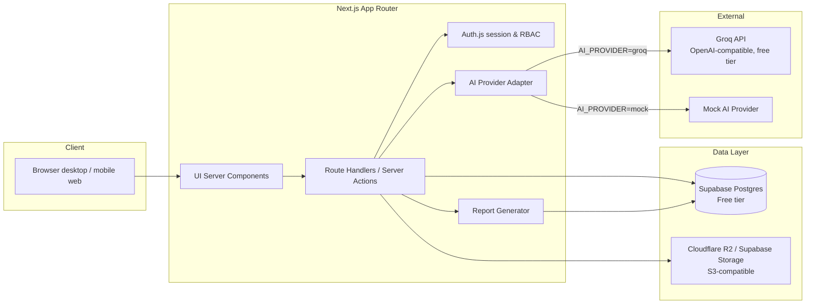
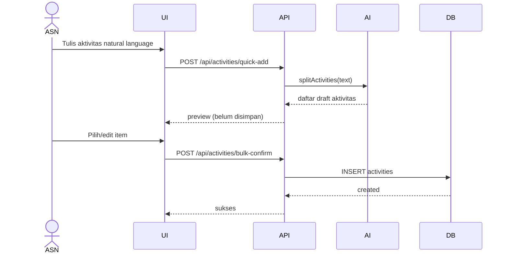

# Spesifikasi Teknologi — SKPFlow

**Versi:** 1.0  
**Status:** Prototipe / Hackathon  
**Dokumen terkait:** `PRD_SKPFlow_ASN.md`, `PRD_ERD.md`, `seed.sql`, `PRODUCT.md`, `mockup_dashboard.svg`, `mockup_mobile_add.svg`

---

## 1. Ringkasan

SKPFlow adalah aplikasi web responsif untuk membantu ASN mencatat aktivitas harian, menghubungkan aktivitas ke target kinerja, menyimpan bukti dukung, serta menghasilkan draft laporan bulanan yang dapat diedit dan ditinjau atasan.

Dokumen ini menetapkan arsitektur, stack, kontrak API, aturan keamanan, integrasi AI, strategi pengujian, dan rencana deployment untuk prototipe. Fokusnya adalah implementasi yang cepat, dapat didemokan, dan tidak mengorbankan integritas data.

---

## 2. Tujuan dan Ruang Lingkup

### 2.1 Tujuan teknis

1. Menyediakan satu aplikasi full-stack yang dapat dijalankan lokal dan di-deploy cepat.
2. Menjaga data aktivitas, target, laporan, dan bukti dukung tetap konsisten dan dapat diaudit.
3. Memastikan AI hanya merapikan dan menyarankan, tidak mengarang fakta atau menyimpan data tanpa konfirmasi pengguna.
4. Menegakkan RBAC dan pembatasan data sesuai peran.
5. Menghasilkan UI responsif desktop dan mobile sesuai mockup.

### 2.2 Di luar ruang lingkup teknis

- Integrasi langsung ke e-Kinerja atau sistem penilaian resmi.
- Tanda tangan elektronik tersertifikasi.
- Payroll, integrasi kepegawaian nasional, atau workflow birokrasi yang sepenuhnya configurable.
- Pengambilan otomatis data dari email, kalender, chat, atau sistem tiket.
- Multi-tenant lintas instansi pada fase prototipe.

---

## 3. Arsitektur Sistem



**Prinsip arsitektur**

- **Monolit modular**: satu aplikasi Next.js dengan pemisahan domain yang jelas (`activities`, `targets`, `reports`, `ai`, `admin`). Tidak ada microservice pada fase prototipe.
- **Server-first**: data fetching dan mutasi lewat server; client hanya untuk interaksi.
- **PostgreSQL sebagai sumber kebenaran**: laporan menyimpan snapshot aktivitas dan section yang sudah diedit.
- **AI sebagai adapter**: provider dapat diganti tanpa mengubah domain logic; mode mock wajib berfungsi tanpa API key.

---

## 4. Stack Teknologi

| Layer | Pilihan | Alasan |
|---|---|---|
| Bahasa | TypeScript 5.x | Type safety end-to-end |
| Framework | Next.js 15 (App Router) | SSR, routing, route handlers, deploy cepat |
| UI | React 19 + Tailwind CSS 4 | Responsif, token tema via CSS variables |
| Komponen | shadcn/ui (Radix primitives) | Aksesibel, konsisten, mudah dikustomisasi |
| Grafik | Recharts | Grafik 7 hari dan kategori |
| Validasi | Zod | Validasi request/response dan form |
| ORM | Prisma | Migrasi, type-safe query, relasi |
| Database | Supabase Postgres (Free) | Sesuai ERD dan `seed.sql`; connection pooling untuk serverless |
| Autentikasi | Auth.js (NextAuth) Credentials | Login NIP/email, session JWT/httpOnly |
| AI | Vercel AI SDK + Groq (OpenAI-compatible, free) | Streaming opsional; fallback `MockProvider` |
| Penyimpanan | Cloudflare R2 / Supabase Storage (S3-compatible) | Bukti dukung; signed URL |
| Testing | Vitest, Playwright, axe-core | Unit, E2E, aksesibilitas |
| Deployment | Vercel Hobby + Supabase Free + Cloudflare R2; Docker Compose alternatif | Gratis untuk prototipe, bisa self-host |
| Observability | Structured logging; Sentry opsional | Debug dan audit |

**Catatan:** Stack dapat diganti selama kontrak API, model data, dan aturan keamanan tetap dipenuhi. Jika tim memilih React + Vite + Express, kontrak di dokumen ini tetap berlaku.

---

## 5. Model Data

Model mengikuti `PRD_ERD.md`. Tabel utama:

| Tabel | Fungsi |
|---|---|
| `roles` | ASN, Atasan, Admin |
| `units` | Unit kerja dan hierarki (`parent_unit_id`) |
| `users` | Profil, NIP, role, unit, atasan langsung |
| `categories` | Kategori aktivitas |
| `targets` | Target kinerja per pengguna |
| `activities` | Aktivitas harian |
| `attachments` | Bukti dukung aktivitas |
| `tags`, `activity_tags` | Tag dan relasi many-to-many |
| `reports` | Header laporan bulanan dan status |
| `report_sections` | Section laporan yang dapat diedit |
| `report_reviews` | Komentar/review atasan |
| `report_activities` | Snapshot aktivitas yang masuk laporan |
| `weekly_summaries` | Ringkasan mingguan yang disimpan |
| `report_templates` | Template laporan dari admin |
| `audit_logs` | Jejak audit |
| `settings` | Konfigurasi aplikasi |

### 5.1 Penyempurnaan yang disarankan

Tambahan kecil pada implementasi, tanpa mengubah semantik ERD:

| Kolom | Tabel | Tujuan |
|---|---|---|
| `generated_at` | `reports` | Membedakan hasil generate vs edit pengguna |
| `is_user_edited` | `report_sections` | Mencegah regenerate menimpa editan tanpa konfirmasi |
| `deleted_at` | `activities` | Soft delete opsional; aktivitas yang dihapus tidak muncul di rekap |
| `storage_key` | `attachments` | Path objek di storage, terpisah dari `file_name` |

### 5.2 Indeks minimum

```sql
CREATE INDEX idx_activities_user_date ON activities (user_id, date DESC);
CREATE INDEX idx_activities_target ON activities (target_id);
CREATE INDEX idx_activities_category ON activities (category_id);
CREATE INDEX idx_reports_user_period ON reports (user_id, period_year, period_month);
CREATE INDEX idx_report_sections_report ON report_sections (report_id, sort_order);
CREATE INDEX idx_report_reviews_report ON report_reviews (report_id, created_at);
CREATE INDEX idx_audit_logs_created ON audit_logs (created_at DESC);
```

### 5.3 Aturan data

- Tanggal aktivitas disimpan sebagai `date` (tanggal lokal, tanpa timezone).
- Timestamp disimpan dalam UTC; ditampilkan dalam `Asia/Jakarta`.
- `activity.target_id` opsional; target yang tidak aktif atau di luar periode tidak disarankan untuk aktivitas baru.
- `report_activities` adalah snapshot: perubahan aktivitas setelah laporan dibuat tidak otomatis mengubah laporan.
- `report_sections` adalah sumber konten laporan yang ditampilkan; `report_activities` dipakai untuk traceability.

### 5.4 Supabase + Prisma

- Runtime memakai **Supabase Transaction Pooler** (`DATABASE_URL`, port `6543`, `?pgbouncer=true&connection_limit=1`).
- Migrasi dan seed memakai `DIRECT_URL` (direct connection, port `5432`).
- Prisma schema: `url = env("DATABASE_URL")`, `directUrl = env("DIRECT_URL")`.
- Jangan mengekspos service role key ke client; akses database hanya dari server.

---

## 6. API

Base path: `/api`. Format respons:

```json
{
  "data": {},
  "meta": { "page": 1, "limit": 20, "total": 100 },
  "error": null
}
```

Error:

```json
{
  "data": null,
  "error": { "code": "FORBIDDEN", "message": "Anda tidak memiliki akses." }
}
```

### 6.1 Autentikasi dan profil

| Method | Path | Deskripsi |
|---|---|---|
| POST | `/api/auth/login` | Login dengan email/NIP dan password |
| POST | `/api/auth/logout` | Logout |
| GET | `/api/auth/me` | Profil dan role pengguna aktif |
| PATCH | `/api/me` | Ubah profil sendiri |

### 6.2 Aktivitas

| Method | Path | Deskripsi |
|---|---|---|
| GET | `/api/activities` | Daftar aktivitas; filter `date`, `from`, `to`, `categoryId`, `targetId`, `status`, `q`, `page`, `limit` |
| POST | `/api/activities` | Buat aktivitas |
| GET | `/api/activities/:id` | Detail aktivitas |
| PATCH | `/api/activities/:id` | Ubah aktivitas milik sendiri |
| DELETE | `/api/activities/:id` | Hapus aktivitas milik sendiri |
| POST | `/api/activities/quick-add` | Preview pemecahan teks natural language oleh AI; **tidak menyimpan** |
| POST | `/api/activities/bulk-confirm` | Simpan item hasil preview yang dipilih pengguna |
| POST | `/api/activities/:id/attachments` | Unggah bukti dukung |
| DELETE | `/api/attachments/:id` | Hapus bukti dukung |

### 6.3 Target kinerja

| Method | Path | Deskripsi |
|---|---|---|
| GET | `/api/targets` | Daftar target milik sendiri |
| POST | `/api/targets` | Buat target |
| PATCH | `/api/targets/:id` | Ubah target |
| POST | `/api/targets/:id/archive` | Arsipkan target |
| GET | `/api/targets/:id/activities` | Aktivitas terkait dan realisasi |

### 6.4 Dashboard dan rekap

| Method | Path | Deskripsi |
|---|---|---|
| GET | `/api/dashboard/summary` | Jumlah aktivitas hari ini/bulan ini, target aktif, status laporan |
| GET | `/api/dashboard/activities-7-days` | Data grafik 7 hari terakhir |
| GET | `/api/dashboard/categories` | Agregasi aktivitas per kategori |
| GET | `/api/weekly-summaries` | Rekap mingguan; query `weekStart` |
| POST | `/api/weekly-summaries/generate` | Generate ringkasan mingguan |
| PATCH | `/api/weekly-summaries/:id` | Simpan editan ringkasan |

### 6.5 Laporan bulanan

| Method | Path | Deskripsi |
|---|---|---|
| GET | `/api/reports` | Daftar laporan; filter periode/status |
| POST | `/api/reports/generate` | Generate draft laporan untuk `periodMonth`/`periodYear` |
| GET | `/api/reports/:id` | Detail laporan + sections + review |
| PATCH | `/api/reports/:id/sections/:key` | Edit satu section |
| POST | `/api/reports/:id/submit` | Ajukan ke atasan |
| POST | `/api/reports/:id/reviews` | Atasan memberi komentar/revisi/approval |
| GET | `/api/reports/:id/export` | Export PDF/DOCX |

### 6.6 AI

| Method | Path | Deskripsi |
|---|---|---|
| POST | `/api/ai/format` | Rapikan narasi aktivitas |
| POST | `/api/ai/summarize-week` | Ringkas aktivitas mingguan |
| POST | `/api/ai/suggest-category` | Saran kategori |
| POST | `/api/ai/suggest-target` | Saran mapping target |
| POST | `/api/ai/report-section` | Bantu menyusun section laporan |

Semua endpoint AI menerima data yang sudah difilter sesuai kewenangan pengguna; server tidak mengirim data di luar scope.

### 6.7 Admin

| Method | Path | Deskripsi |
|---|---|---|
| GET/POST | `/api/admin/users` | Daftar/buat pengguna |
| PATCH | `/api/admin/users/:id` | Ubah role, unit, atasan, status |
| GET/POST | `/api/admin/units` | Unit kerja |
| GET/POST | `/api/admin/categories` | Kategori aktivitas |
| GET/POST | `/api/admin/report-templates` | Template laporan |
| GET | `/api/admin/audit-logs` | Audit log |
| GET/PATCH | `/api/admin/settings` | Konfigurasi aplikasi |

### 6.8 Aturan umum API

- Semua endpoint privat memerlukan session valid.
- Mutasi memerlukan `Origin`/`Referer` yang cocok dan cookie `SameSite=Lax`.
- Pagination default `limit=20`, maksimum `100`.
- Validasi input dengan Zod; error 422 menyertakan field yang gagal.
- ID resource diperiksa terhadap scope pengguna sebelum operasi (mencegah IDOR).
- Respons tidak pernah mengembalikan `password_hash`.

---

## 7. Alur Teknis Utama

### 7.1 Quick add dengan AI



**Aturan:** tidak ada aktivitas hasil AI yang tersimpan sebelum pengguna mengonfirmasi. Setiap item preview dapat diedit, dipilih, atau dibatalkan.

### 7.2 Generate laporan bulanan

1. Validasi `periodMonth`/`periodYear` dan hak akses.
2. Ambil aktivitas pengguna pada periode tersebut.
3. Agregasi: total aktivitas, status, kategori, target, output, kendala, tindak lanjut.
4. Buat `reports` (status `draft`) dan `report_sections` awal.
5. Simpan `report_activities` sebagai snapshot.
6. Tandai section yang belum diedit sebagai `is_user_edited = false`.
7. Regenerate:
   - Section dengan `is_user_edited = false` boleh diperbarui.
   - Section dengan `is_user_edited = true` dipertahankan; jika pengguna meminta timpa, minta konfirmasi eksplisit dan catat audit log.

### 7.3 Review atasan

1. Atasan membuka laporan bawahan dalam scope supervisi.
2. Atasan memberi `comment`, `revision`, atau `approved` pada `report_reviews`.
3. Status laporan berubah: `submitted` → `revision` atau `approved`.
4. Setiap perubahan status dicatat di `audit_logs`.
5. ASN melihat komentar dan dapat memperbaiki lalu submit ulang.

---

## 8. Autentikasi dan Otorisasi

### 8.1 Autentikasi

- Login dengan email atau NIP + password.
- Password di-hash dengan Argon2id (disarankan) atau bcrypt cost ≥ 12.
- Session menggunakan JWT/httpOnly cookie; `Secure` di production; `SameSite=Lax`.
- Session berisi `userId`, `role`, `unitId`; data sensitif tidak disimpan di cookie.
- Logout menghapus cookie dan (opsional) mencatat audit.

### 8.2 Otorisasi

| Peran | Akses |
|---|---|
| ASN | Data milik sendiri: profil, aktivitas, target, bukti dukung, rekap, laporan |
| Atasan | Data bawahan dalam scope supervisi: aktivitas, target, laporan, review, rekap unit |
| Admin | Pengguna, role, unit, kategori, template, audit log, settings; tidak otomatis mendapat akses konten aktivitas |

**Scope supervisi:** bawahan langsung dan tidak langsung dihitung secara rekursif dari `users.atasan_id` (recursive CTE). Untuk rekap unit, gunakan `units.parent_unit_id` dan scope unit atasan. Setiap query wajib menyertakan predicate scope, bukan hanya pengecekan di UI.

**Helper yang disarankan:**

```ts
type SessionUser = { id: string; role: "ASN" | "Atasan" | "Admin"; unitId: string };
function requireRole(user: SessionUser, roles: SessionUser["role"][]): void;
function canAccessUser(actor: SessionUser, targetUserId: string): Promise<boolean>;
function canAccessReport(actor: SessionUser, report: Report): Promise<boolean>;
```

---

## 9. Integrasi AI

### 9.1 Prinsip

1. **Grounded**: AI hanya menerima data yang benar-benar ada pada aktivitas/target pengguna.
2. **No invented facts**: output tidak boleh menambah tanggal, angka, output, capaian, atau nama yang tidak ada di input.
3. **User confirms**: semua output AI dapat diedit dan tidak disimpan tanpa konfirmasi.
4. **Fallback**: `AI_PROVIDER=mock` menghasilkan output deterministik tanpa API key.
5. **Least data**: hanya kirim field yang diperlukan; jangan kirim NIP/email jika tidak relevan.

### 9.2 Interface adapter

```ts
export interface AIProvider {
  splitActivities(input: string): Promise<DraftActivity[]>;
  formatActivity(input: ActivityDraft): Promise<string>;
  summarizeWeek(input: WeekSummaryInput): Promise<string>;
  generateReportSection(input: ReportSectionInput): Promise<string>;
  suggestCategory(input: string): Promise<CategorySuggestion[]>;
  suggestTarget(input: string, targets: Target[]): Promise<TargetSuggestion[]>;
}
```

Implementasi:
- `OpenAICompatibleProvider` — memakai `AI_BASE_URL`, `AI_API_KEY`, `AI_MODEL`.
- `MockProvider` — template deterministik, misalnya mengubah kalimat menjadi bentuk formal sederhana dan memecah berdasarkan konjungsi.

### 9.3 Fact-lock

Sebelum output AI ditampilkan:

1. Ekstrak angka, tanggal, dan nama entitas dari input.
2. Bandingkan dengan output.
3. Jika output memuat angka/tanggal baru yang tidak ada di input, tandai `needs_review` dan tampilkan peringatan.
4. Jangan pernah mengisi field output/kuantitas secara otomatis dari AI; pengguna yang mengisi atau mengonfirmasi.

### 9.4 Prompt dan logging

- Prompt disimpan di `src/lib/ai/prompts/` dan diberi versi.
- Log metadata: provider, model, latency, token usage, `userId`, `requestId`. Jangan log isi penuh data pribadi.
- Timeout 20 detik; retry maksimal 1 kali untuk error 5xx/rate limit.
- Rate limit AI: 20 permintaan/menit/pengguna.

### 9.5 Provider gratis: Groq

- Daftar di `console.groq.com`, buat API key (tanpa kartu kredit).
- Set `AI_PROVIDER=groq`, `AI_BASE_URL=https://api.groq.com/openai/v1`, `AI_MODEL=llama-3.3-70b-versatile`.
- Groq kompatibel dengan OpenAI Chat Completions, sehingga adapter `OpenAICompatibleProvider` dapat dipakai langsung.
- Free tier dibatasi per model (contoh `gpt-oss-120b`: 30 RPM, 1.000 request/hari, 200K token/hari). Jika kuota habis, fallback ke `AI_PROVIDER=mock`.

---

## 10. Penyimpanan Bukti Dukung

- Upload multipart ke `POST /api/activities/:id/attachments`.
- Batas ukuran: 10 MB (dapat dikonfigurasi `MAX_UPLOAD_MB`).
- MIME yang diizinkan: `application/pdf`, `image/png`, `image/jpeg`, `text/plain`, `application/vnd.openxmlformats-officedocument.wordprocessingml.document`, `application/vnd.openxmlformats-officedocument.spreadsheetml.sheet`.
- Validasi MIME dari magic bytes, bukan hanya header klien.
- Nama objek: `activities/{activityId}/{uuid}-{sanitizedFilename}`.
- Metadata disimpan di `attachments`; file disimpan di storage.
- Download melalui signed URL berumur pendek (mis. 5 menit) atau route yang memeriksa otorisasi.
- Hapus file saat aktivitas dihapus permanen; soft delete tidak menghapus file sampai purge.
- Untuk production, opsional scan antivirus (ClamAV) sebelum file tersedia.

### 10.1 Konfigurasi R2 / Supabase Storage

| Penyedia | Endpoint | Region | Force path style | Free tier |
|---|---|---|---|---|
| Cloudflare R2 | `https://<account-id>.r2.cloudflarestorage.com` | `auto` | `false` | 10 GB |
| Supabase Storage | `https://<ref>.supabase.co/storage/v1/s3` | region proyek | `true` | 1 GB |

- Bucket dibuat **privat**; akses file melalui signed URL berumur pendek.
- Gunakan `@aws-sdk/client-s3` dan `@aws-sdk/s3-request-presigner`.
- Jangan menyimpan access key di client; hanya di environment variable server.
- Jika memakai R2, konfigurasi CORS untuk origin Vercel dan methods `GET, PUT, POST`.

---

## 11. Generator Laporan

### 11.1 Struktur section

`identity`, `executive_summary`, `daily_recap`, `target_achievement`, `output_recap`, `obstacles`, `closing`.

### 11.2 Sumber data

| Section | Sumber |
|---|---|
| `identity` | `users`, `units` |
| `executive_summary` | Agregasi aktivitas + AI (opsional) |
| `daily_recap` | `activities` pada periode |
| `target_achievement` | `targets` + aktivitas terkait |
| `output_recap` | `activities.output`, `quantity`, `unit` |
| `obstacles` | `activities.obstacle`, `follow_up` |
| `closing` | Template + catatan pengguna |

### 11.3 Aturan

- Hanya aktivitas pada periode yang dipilih.
- Aktivitas tanpa output ditandai “belum ada output”, bukan diisi otomatis.
- Setiap section dapat diedit dan disimpan.
- Laporan dapat disimpan sebagai draft, dipreview, dan diekspor.
- Regenerate tidak menghilangkan editan pengguna tanpa konfirmasi.
- Export PDF menggunakan template server-side; DOCX opsional.

---

## 12. Non-Functional Requirements

| Aspek | Target |
|---|---|
| Performa API CRUD | p95 < 500 ms |
| Dashboard | p95 < 1 s untuk 1 pengguna |
| Daftar aktivitas | Pagination; maksimum 100 item per request |
| Ketersediaan | Prototipe single-region; target 99% untuk demo |
| Responsif | 390 px, 768 px, 1024 px, 1440 px |
| Browser | 2 versi terakhir Chrome, Edge, Firefox, Safari |
| Aksesibilitas | WCAG 2.1 AA: keyboard, focus visible, kontras, label form |
| Timezone | Simpan UTC; tampilkan `Asia/Jakarta` |
| Bahasa | Bahasa Indonesia untuk prototipe; string terpusat untuk i18n nanti |
| Backup | Backup harian PostgreSQL; seed demo dapat dipulihkan. Untuk Supabase Free, export `pg_dump` berkala via `DIRECT_URL` |
| Logging | Structured JSON log; `requestId` di setiap request |
| Observability | Endpoint `/api/health` untuk keep-alive Supabase; Sentry Free opsional |
| Batas free tier | Supabase pause setelah 7 hari idle (mitigasi: cron `/api/health`). R2 10 GB / Supabase Storage 1 GB. Groq rate limit per model; fallback mock saat 429 |

---

## 13. Keamanan

- **Password:** Argon2id; jika bcrypt, cost ≥ 12. Tidak pernah log password.
- **Session:** httpOnly, Secure, SameSite=Lax; rotasi secret berkala.
- **CSRF:** SameSite cookie + validasi `Origin` untuk mutasi.
- **IDOR:** setiap resource diperiksa terhadap `userId`/scope, bukan hanya role.
- **SQL injection:** Prisma/parameterized query; tidak ada string concatenation SQL.
- **XSS:** sanitasi markdown laporan (mis. `rehype-sanitize`); CSP ketat.
- **Upload:** validasi magic bytes, batas ukuran, nama file disanitasi, file tidak dieksekusi.
- **Rate limit:** login 5/menit/IP; AI 20/menit/pengguna; upload 10/menit/pengguna.
- **Audit:** login, perubahan role/unit, submit/approve/revisi laporan, perubahan settings.
- **Secrets:** hanya via environment variable; `.env` tidak di-commit.
- **CSP contoh:** `default-src 'self'; img-src 'self' data: blob:; connect-src 'self' https://api.openai.com; frame-ancestors 'none'`.

---

## 14. Pengujian

| Jenis | Alat | Cakupan |
|---|---|---|
| Unit | Vitest | Agregasi laporan, fact-lock, authorization helper |
| Integration | Vitest + Testcontainers PostgreSQL | Route handlers, migrasi, seed |
| E2E | Playwright | Login, CRUD aktivitas, quick add, generate laporan, review atasan |
| Accessibility | axe-core di Playwright | Halaman utama dan form |
| Seed validation | `psql -f seed.sql` di CI | Memastikan seed berjalan di schema terbaru |

**Skenario E2E minimum:**

1. ASN login → dashboard menampilkan data.
2. ASN membuat aktivitas → muncul di daftar dan dashboard.
3. ASN quick add → preview AI → pilih item → simpan.
4. ASN membuat target → menghubungkan aktivitas ke target.
5. ASN generate laporan → edit section → submit.
6. Atasan login → buka laporan bawahan → beri revisi → ASN melihat komentar.
7. Admin membuat kategori → muncul di form aktivitas.
8. ASN mencoba mengakses aktivitas ASN lain → 403.

---

## 15. Deployment dan Operasi

### 15.1 Rekomendasi gratis (Vercel + Supabase + S3)

Kombinasi yang direkomendasikan untuk prototipe tanpa biaya:

| Layanan | Free tier | Catatan |
|---|---|---|
| **Vercel Hobby** | 100 GB Fast Data Transfer, 10 GB Fast Origin Transfer, 1 juta function invocation, 4 CPU-jam, 1 juta CDN request per bulan | Cukup untuk demo; 100 deployment/hari |
| **Supabase Free** | 500 MB database, 1 GB file storage, 5 GB egress, 5 GB cached egress, 50.000 MAU, 2 proyek aktif | Proyek **pause setelah 7 hari idle** |
| **Cloudflare R2 Free** | 10 GB storage, 1 juta Class A, 10 juta Class B, egress gratis | S3-compatible; perlu aktivasi R2 |
| **Supabase Storage** | 1 GB storage, 5 GB cached egress, max upload 50 MB | Alternatif S3-compatible satu vendor |
| **Groq Free** | Rate limit per model; contoh `gpt-oss-120b`: 30 RPM, 1.000 request/hari, 200K token/hari | OpenAI-compatible, tanpa kartu kredit |
| **GitHub Actions** | 2.000 menit/bulan (private repo) | CI + cron keep-alive |
| **Sentry Free** | 5.000 error/bulan | Opsional |

**Rekomendasi utama:** Vercel Hobby + Supabase Free (Postgres) + Cloudflare R2 Free (S3-compatible) + Groq Free (AI). Jika ingin satu vendor saja, ganti R2 dengan Supabase Storage (1 GB, S3-compatible API).

> Batas free tier dapat berubah. Cek halaman pricing resmi sebelum demo: `supabase.com/pricing`, `developers.cloudflare.com/r2/pricing`, `vercel.com/docs/plans/hobby`, `console.groq.com/docs/rate-limits`.

### 15.2 Environment variable

| Variable | Wajib | Contoh |
|---|---|---|
| `DATABASE_URL` | Ya | Supabase **pooler** URL, port `6543`, `?pgbouncer=true&connection_limit=1` |
| `DIRECT_URL` | Ya | Supabase direct URL, `db.<ref>.supabase.co:5432` (untuk migrasi/seed) |
| `AUTH_SECRET` | Ya | random 32+ byte |
| `AUTH_URL` | Ya | `https://skpflow.vercel.app` |
| `AI_PROVIDER` | Ya | `groq` atau `mock` |
| `AI_API_KEY` | Jika `groq` | Groq API key |
| `AI_BASE_URL` | Jika `groq` | `https://api.groq.com/openai/v1` |
| `AI_MODEL` | Tidak | `llama-3.3-70b-versatile` atau `gpt-oss-120b` |
| `STORAGE_DRIVER` | Ya | `s3` atau `local` |
| `S3_ENDPOINT` | Jika `s3` | R2: `https://<account-id>.r2.cloudflarestorage.com`; Supabase: `https://<ref>.supabase.co/storage/v1/s3` |
| `S3_BUCKET` | Jika `s3` | `skpflow-evidence` |
| `S3_ACCESS_KEY_ID` | Jika `s3` | dari R2 API token / Supabase Storage access key |
| `S3_SECRET_ACCESS_KEY` | Jika `s3` | — |
| `S3_REGION` | Jika `s3` | R2: `auto`; Supabase: region proyek |
| `S3_FORCE_PATH_STYLE` | Jika `s3` | `true` untuk Supabase Storage; `false` untuk R2 |
| `MAX_UPLOAD_MB` | Tidak | `10` (Supabase max 50 MB) |
| `APP_TIMEZONE` | Tidak | `Asia/Jakarta` |

### 15.3 Prisma + Supabase (wajib untuk Vercel serverless)

```prisma
datasource db {
  provider  = "postgresql"
  url       = env("DATABASE_URL")
  directUrl = env("DIRECT_URL")
}
```

- `DATABASE_URL` memakai **Supabase Transaction Pooler** (port `6543`) dengan `?pgbouncer=true&connection_limit=1` agar aman di Vercel serverless.
- `DIRECT_URL` memakai koneksi langsung (port `5432`) untuk `prisma migrate deploy` dan `seed.sql`.
- `package.json`: `"postinstall": "prisma generate"`.
- Build command Vercel: `prisma generate && next build`.
- Migrasi dijalankan dari lokal/CI: `npx prisma migrate deploy` (dengan `DIRECT_URL` aktif).
- Seed: `psql "$DIRECT_URL" -f seed.sql` setelah migrasi.

### 15.4 Setup Vercel + Supabase + R2

**Supabase**

1. Buat project Free di Supabase; catat region.
2. Buka **Project Settings → Database → Connection string**.
3. Salin **Transaction pooler** ke `DATABASE_URL` (tambahkan `?pgbouncer=true&connection_limit=1`).
4. Salin **Direct connection** ke `DIRECT_URL`.
5. Jalankan migrasi dan `seed.sql` dari lokal.
6. Untuk storage alternatif: **Storage → S3 access**; buat access key, catat endpoint, region, dan bucket.

**Cloudflare R2**

1. Aktifkan R2 di dashboard Cloudflare.
2. Buat bucket privat `skpflow-evidence`.
3. Buat API token dengan izin **Object Read & Write** untuk bucket tersebut.
4. Catat `S3_ENDPOINT`, `S3_ACCESS_KEY_ID`, `S3_SECRET_ACCESS_KEY`; region `auto`.
5. Atur CORS bucket: origin `https://<app>.vercel.app`, methods `GET, PUT, POST`, headers `*`.
6. Jangan aktifkan public access; akses file lewat **signed URL** berumur pendek.

**Vercel**

1. Push repo ke GitHub.
2. Import project di Vercel; framework preset **Next.js**.
3. Build command: `prisma generate && next build`.
4. Tambahkan semua environment variable untuk Production, Preview, dan Development.
5. Deploy. Gunakan domain `*.vercel.app` (gratis) atau custom domain.
6. Jalankan smoke test: login, dashboard, create activity, upload bukti, generate laporan.

### 15.5 Menjaga Supabase Free tetap aktif

Supabase Free mem-pause project setelah 7 hari tanpa aktivitas. Buat endpoint `GET /api/health` yang menjalankan `SELECT 1`, lalu panggil secara harian:

- **Vercel Cron** (Hobby): tambahkan `vercel.json` dengan jadwal harian.
- **GitHub Actions** (alternatif): workflow `schedule: cron: "0 1 * * *"` yang memanggil `https://<app>.vercel.app/api/health`.

### 15.6 CI/CD

1. Install dependencies.
2. Lint + typecheck.
3. Unit dan integration test.
4. Build Next.js.
5. `prisma migrate deploy` ke database staging (dengan `DIRECT_URL`).
6. Jalankan `seed.sql` di staging.
7. Deploy (Vercel otomatis dari GitHub).
8. Smoke test: login, dashboard, create activity.

### 15.7 Opsi lokal / self-host

Docker Compose untuk development:

- Service: `app`, `postgres`, `minio`.
- Volume untuk Postgres dan MinIO.
- Reverse proxy (Caddy/Nginx) untuk HTTPS.
- Gunakan `STORAGE_DRIVER=local` atau MinIO sebagai S3-compatible.

---

## 16. Risiko dan Keputusan Terbuka

| Risiko | Dampak | Mitigasi |
|---|---|---|
| AI mengarang fakta | Laporan tidak valid | Grounding, fact-lock, edit wajib, mock mode |
| Regenerate menimpa editan | Kehilangan pekerjaan pengguna | `is_user_edited`, konfirmasi, audit log |
| Scope atasan salah | Data bocor | Recursive CTE + test otorisasi |
| File upload berbahaya | Malware/XSS | Validasi MIME, sanitasi nama, scan opsional, CSP |
| Data demo bercampur produksi | Kebingungan | Seed hanya di dev/staging; flag environment |
| Waktu hackathon terbatas | Fitur tidak selesai | Prioritas: auth, aktivitas, quick add, laporan, review |
| Stack berubah | Dokumen tidak sesuai | Kontrak API dan model data dijaga |
| Supabase Free pause | Aplikasi gagal konek saat demo | Cron `/api/health` harian; siapkan upgrade Pro jika demo kritis |
| Kuota Groq habis | Fitur AI tidak tersedia | Fallback `AI_PROVIDER=mock`; cache hasil; batasi request |
| Batas storage R2/Supabase | Upload bukti gagal | Batas 10 MB; kompresi gambar; hapus file yatim |
| Kuota Vercel Hobby habis | Deploy/function berhenti | Monitor usage; hindari request berat; upgrade Pro jika perlu |

**Keputusan terbuka:**

- Apakah admin boleh melihat konten aktivitas untuk keperluan audit? Disarankan **tidak** pada prototipe.
- Apakah laporan memerlukan versioning penuh? Disarankan **tidak**; cukup `is_user_edited` + audit log.
- Apakah export DOCX diperlukan? Disarankan PDF untuk prototipe, DOCX opsional.
- Apakah notifikasi email diperlukan? Di luar scope prototipe.

---

## 17. Rencana Implementasi (Hackathon)

| Hari | Fokus | Output |
|---|---|---|
| 1 | Scaffold, database, auth, seed | Login, RBAC dasar, data demo |
| 2 | Aktivitas, target, upload | CRUD aktivitas, target, bukti dukung |
| 3 | Dashboard, quick add, rekap, laporan | Dashboard, AI mock, generate laporan |
| 4 | Review, export, testing, deploy | Alur atasan, PDF, E2E, deploy Vercel + Supabase + R2, demo live |

**Definition of done prototipe:**

- Semua alur utama PRD dapat didemokan end-to-end.
- `seed.sql` berjalan di database baru.
- Tidak ada data lintas pengguna yang bocor.
- AI mock berfungsi tanpa API key.
- Build production sukses dan aplikasi dapat diakses dari desktop dan mobile.
- Deploy Vercel berhasil dengan Supabase Postgres + Cloudflare R2/Supabase Storage dan environment variable production.

---

## 18. Referensi Artefak

- `PRD_SKPFlow_ASN.md` — kebutuhan produk dan acceptance criteria.
- `PRD_ERD.md` — ERD database.
- `seed.sql` — data demo PostgreSQL.
- `PRODUCT.md` — konteks produk.
- `mockup_dashboard.svg` — arah visual dashboard desktop.
- `mockup_mobile_add.svg` — arah visual quick add mobile.